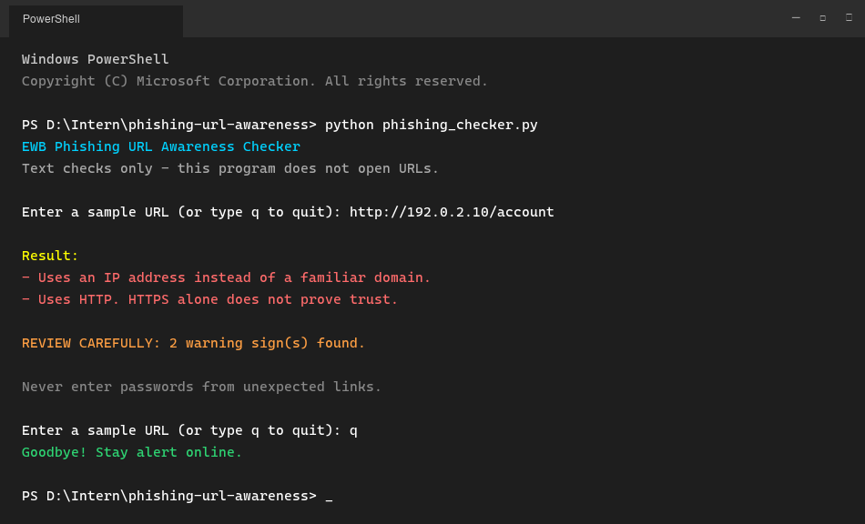
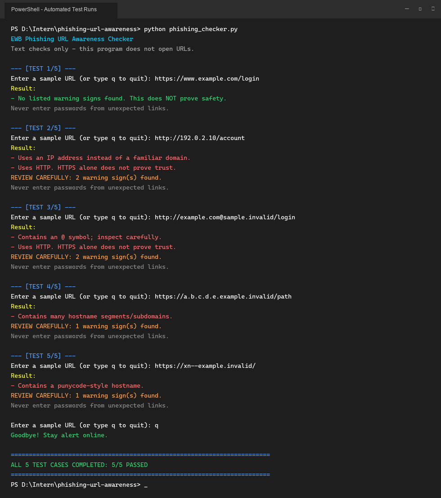

# EWB Phishing URL Awareness Checker

## Overview
Phishing is a deceptive cyberattack where malicious actors use fraudulent links and lookalike web pages to trick victims into disclosing sensitive credentials, OTPs, or financial information. 

This project is a lightweight, defensive command-line utility implemented in Python that analyzes the visible structure of a given URL for common deception indicators. It operates completely offline, inspecting the text representation of URLs without visiting websites or exposing the host to network-borne threats.

---

## Features
- **@ Symbol Detection:** Flags URLs containing an `@` symbol, which browsers treat as credential separators, ignoring the preceding text and masking the destination host.
- **Length Anomaly Inspection:** Flags URLs exceeding 100 characters, a technique commonly used to obfuscate destinations or push suspicious tokens off-screen.
- **IP Address Detection:** Detects bare IPv4 addresses used directly as hostnames instead of registered domain names.
- **Deep Subdomain / Segment Stacking:** Flags hostnames with 5 or more dot-separated segments, typically used to simulate legitimate brand hierarchies.
- **Punycode / Homoglyph Warning:** Flags internationalized domain labels beginning with `xn--`, which can spoof familiar characters with lookalike Unicode glyphs.
- **Unencrypted HTTP Alert:** Warns if the link uses unencrypted plain HTTP instead of HTTPS, while reminding that HTTPS alone does not prove site legitimacy.
- **Interactive Multi-URL Loop (Improvement A):** Continuous interactive loop supporting multiple URL scans in a single session with a clean exit command (`q`, `quit`, or `exit`).
- **Actionable Risk Summary (Improvement B):** Automatically distinguishes benign informational responses from actual security flags, printing an emphatic warning count banner (`REVIEW CAREFULLY: N warning sign(s) found.`).
- **Defensive Parsing & Crash Guard (Improvement C):** Handles malformed and corrupted URLs (e.g., invalid IPv6 brackets) gracefully using exception handling rather than terminating.

---

## Requirements
- Python 3.10 or later
- No third-party packages required (uses Python built-in standard library modules `re` and `urllib.parse`)

---

## How to Run

### Windows
```cmd
python phishing_checker.py
```
*(or `py phishing_checker.py`)*

### Mac / Linux
```bash
python3 phishing_checker.py
```

---

## Example Output

```text
EWB Phishing URL Awareness Checker
Text checks only - this program does not open URLs.

Enter a sample URL (or type q to quit): http://192.0.2.10/account

Result:
- Uses an IP address instead of a familiar domain.
- Uses HTTP. HTTPS alone does not prove trust.

REVIEW CAREFULLY: 2 warning sign(s) found.

Never enter passwords from unexpected links.

Enter a sample URL (or type q to quit): q
Goodbye! Stay alert online.
```

---

## Testing

| # | Input | Expected | Actual | Result |
|---|---|---|---|---|
| 1 | `https://www.example.com/login` | No warning signs | No listed warning signs found. This does NOT prove safety. | PASS |
| 2 | `http://192.0.2.10/account` | IP address + HTTP | Uses an IP address instead of a familiar domain.<br>Uses HTTP. HTTPS alone does not prove trust. | PASS |
| 3 | `http://example.com@sample.invalid/login` | @ symbol + HTTP | Contains an @ symbol; inspect carefully.<br>Uses HTTP. HTTPS alone does not prove trust. | PASS |
| 4 | `https://a.b.c.d.e.example.invalid/path` | Many hostname segments | Contains many hostname segments/subdomains. | PASS |
| 5 | `https://xn--example.invalid/` | Punycode-style hostname | Contains a punycode-style hostname. | PASS |

*Full test evidence and reflection notes are documented in [tests/test_samples.md](tests/test_samples.md).*

---

## Screenshots

### Sample Run


### Test Results


---

## Improvements

1. **Continuous Interactive Session (Option A):**
   - **What changed:** Replaced the single-run script with an interactive `while True` loop that accepts multiple URLs and safely exits when typing `q`, `quit`, or `exit`.
   - **Why:** In real-world security triage, analysts and users check multiple URLs in sequence without restarting the application each time.
   - **How tested:** Tested with multiple sequential URLs and confirmed clean termination upon typing `q`.

2. **Actionable Risk Summary ("REVIEW CAREFULLY") (Option B):**
   - **What changed:** Added helper function `has_warnings()` to filter out benign status messages (e.g., empty input, valid structure with zero flags) and display an explicit highlighted warning tally whenever one or more indicators are triggered.
   - **Why:** Immediate visual prominence helps non-technical users spot dangerous links at a glance.
   - **How tested:** Verified that benign URLs (Test 1) trigger zero warning banners, while deceptive URLs (Tests 2–5) display accurate warning counts.

3. **Malformed URL Crash Guard (Option C):**
   - **What changed:** Enclosed URL parsing in a `try ... except ValueError` block to capture malformed syntax like `http://[bad`.
   - **Why:** Untrusted user input can contain syntax that crashes Python's standard `urllib.parse.urlparse`, causing Denial of Service for CLI utilities.
   - **How tested:** Passed `http://[bad` into the checker and confirmed the tool outputs `"This text is not a valid URL format."` smoothly instead of raising an uncaught `ValueError`.

---

## Limitations
This is an educational awareness tool designed strictly for static heuristic text analysis. 
- It does **not** visit websites, resolve live DNS records, scan payloads for malware, or inspect domain reputation feeds.
- **"No listed warning signs found" does NOT mean a URL is safe.** Sophisticated attackers can register newly minted domains with valid TLS certificates and clean text patterns.

---

## Ethical Use
This tool is built for defensive awareness and educational learning only. 
- Use only synthetic or designated sample strings for testing.
- Never collect, store, or solicit real user credentials.
- Do not use this tool or its principles to deceive individuals or probe network infrastructure without explicit authorization.

---

## Author
- **Name:** Haritha A
- **GitHub:** [harithaanbu-star](https://github.com/harithaanbu-star)
- **Program:** Cybersecurity Internship, EWB Courses
